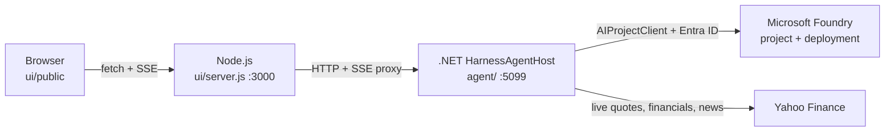

# Harness Agent Playground

A partner-ready demo of the **Agent Harness** in the [Microsoft Agent Framework](https://learn.microsoft.com/en-us/agent-framework/concepts/harness), running against a Microsoft Foundry model deployment.

- **UI**: lightweight Node.js server and vanilla JS front end (`ui/`).
- **Agent**: .NET 10 host that builds a `HarnessAgent` from `Microsoft.Agents.AI.Harness` and streams every run over SSE (`agent/`).
- **State**: per-scenario files the agent saves land in `data/artifacts/`.

Three scenarios show the harness doing real work in three domains. After each run the **Summary** button shows which capabilities were actually exercised, based on what the runtime observed, not on a static list.

## Scenarios

| Scenario | Domain | What it shows |
| --- | --- | --- |
| Investment Thesis Builder | Financial research | Live Yahoo Finance data for Microsoft (MSFT) or any listing. Two **background agents** (`peer-analyst`, `news-analyst`) run in parallel, the **investment-memo skill** sets the format, hosted **web search** checks fresh news, and the memo is saved with **file access**. |
| SRE Incident Commander | DevOps / SRE | Triage a latency alert, then the harness **pauses for human approval** before `rollback_deployment` runs. The post-mortem comes from the **incident-postmortem skill**. Telemetry is simulated. |
| Launch Campaign Studio | Marketing / Product | Personas, channel mix, content calendar and sample copy, shaped by the **campaign-brief skill** and saved as a brief. Research tools are simulated. |

Every scenario starts in **plan** mode: the agent writes a todo list, you approve it, the app switches to **execute** mode, and a `TodoCompletionLoopEvaluator` keeps the agent going until every todo is done.

## Capability matrix: where each one is used

| Harness capability | How this demo uses it | Where you see it |
| --- | --- | --- |
| Function invocation | Typed tools per scenario (`FinanceTools`, `SreTools`, `MarketingTools`) | Tool activity panel |
| Planning and todos | `TodoProvider` + plan/execute `AgentModeProvider` | Flow-chart todo list |
| Bounded looping | `TodoCompletionLoopEvaluator`, plus `BackgroundTaskCompletionLoopEvaluator` when children run | Auto-continue until todos finish |
| Tool approval | `ApprovalRequiredAIFunction` around `restart_service` and `rollback_deployment`; skill read tools auto-approved | Approval card in chat |
| Agent Skills | Code-defined `AgentInlineSkill` per scenario, loaded with `load_skill` | `load_skill` in tool activity |
| Background agents | `HarnessAgentOptions.BackgroundAgents` with two child agents | `background_agents_*` tool calls |
| Shared file access | `FileSystemAgentFileStore` rooted at `data/artifacts/<scenario>` | Files panel and saved-report card |
| Session file memory | Built-in `FileMemoryProvider` | `file_memory_*` tool calls |
| Web search | Default hosted web search tool | Financial scenario |
| Compaction and history | `MaxContextWindowTokens`, per-service-call history | Always on |
| OpenTelemetry | In-process `ActivityListener` on the harness spans | Trace panel |

## Architecture



The agent is built in `agent/HarnessAgentHost/Runtime/HarnessRuntime.cs`:

```csharp
var agent = chatClient.AsHarnessAgent(new HarnessAgentOptions
{
    Name = scenario.Title,
    OpenTelemetrySourceName = "Harness.Playground",
    MaxContextWindowTokens = 128_000,
    AgentModeProviderOptions = new AgentModeProviderOptions { DefaultMode = "plan" },
    LoopEvaluators = [new TodoCompletionLoopEvaluator(new() { Modes = ["execute"] }), new BackgroundTaskCompletionLoopEvaluator()],
    BackgroundAgents = scenario.BackgroundAgentsFactory?.Invoke(chatClient, services),
    AgentSkillsSource = new AgentInMemorySkillsSource(scenario.SkillsFactory!()),
    ToolApprovalAgentOptions = new() { AutoApprovalRules = [AgentSkillsProvider.ReadOnlyToolsAutoApprovalRule] },
    FileAccessStore = new FileSystemAgentFileStore(artifactsDir),
    ChatOptions = new ChatOptions { Instructions = scenario.Instructions, Tools = scenario.ToolFactory(services) },
});
```

### Human approval flow

1. The model calls `rollback_deployment`. The harness returns a `ToolApprovalRequestContent` instead of executing it.
2. The host emits an `approval_request` SSE event; the UI shows the exact tool and arguments.
3. The human clicks Approve or Reject. The UI posts to `/api/agent/approval`.
4. The host resumes the **same session** with `request.CreateResponse(approved, reason)`. If rejected, the model is told and proposes a safer path.

### SSE events

`start`, `message_start`, `text`, `tool_call`, `tool_result`, `approval_request`, `usage`, `done`, `error`, `cancelled`. `done` carries the status snapshot (mode, todos, exercised capabilities, pending approvals).

## Prerequisites

- Node.js 22.5+
- .NET 10 SDK
- Azure CLI signed in (`az login`); Microsoft Entra ID auth only, no keys
- PowerShell 7+ for the launcher
- A Foundry project with a chat deployment. **Give the deployment at least 100K tokens per minute**: a full scenario run uses roughly 100K to 160K tokens, and the UI retries automatically on rate limits but a small quota makes the demo slow.

### Package feeds on Microsoft-managed devices

Direct access to public NuGet and PyPI is blocked. `NuGet.config` in the repo root routes restores through the Central Feed Services proxy (`https://packagefeedproxy.microsoft.io/nuget/v3/index.json`), so `dotnet build` works without changes.

## Quick start

```powershell
.\start.ps1            # boots the .NET host, then the Node UI, then opens the browser
.\start.ps1 -Setup     # first time: wizard that signs in, picks a Foundry project and writes .env
```

Open `http://localhost:3000/`, pick a scenario, use the starter prompt, approve the plan, and watch the todos, tools, trace and files fill in.

## Environment variables (`.env`)

| Key | Consumed by | Example |
| --- | --- | --- |
| `FOUNDRY_PROJECT_ENDPOINT` | .NET host | `https://my-foundry.services.ai.azure.com/api/projects/default-project` |
| `FOUNDRY_MODEL` | .NET host | `gpt-5.2` |
| `HARNESS_PORT` | both | `5099` |
| `PORT` | Node UI | `3000` |

## Testing

`scripts/e2e.mjs` drives the host exactly like the UI: plan, approve, execute with auto-continue, answer tool approvals, then reports todos, exercised capabilities, trace spans and saved files.

```powershell
node scripts/e2e.mjs incident-commander      # TEST_APPROVE=no to reject the rollback
node scripts/e2e.mjs financial-analyst
node scripts/e2e.mjs launch-studio
```

## Notes for presenters

- Market data in the financial scenario is live from Yahoo Finance. SRE and marketing data is simulated and labelled as such in the reports.
- gpt-5.2 occasionally answers the first execute turn with a refusal; the loop evaluator re-prompts and the run continues. The UI hides those bubbles.
- Reset (composer) rotates the session without leaving the scenario.

## References

- [Agent Harness](https://learn.microsoft.com/en-us/agent-framework/concepts/harness)
- [Planning and todos](https://learn.microsoft.com/en-us/agent-framework/agents/planning-and-todos)
- [Tool approval](https://learn.microsoft.com/en-us/agent-framework/agents/tools/tool-approval)
- [Agent Skills](https://learn.microsoft.com/en-us/agent-framework/agents/skills)
- [Background agents](https://learn.microsoft.com/en-us/agent-framework/agents/background-agents)
- [Web search](https://learn.microsoft.com/en-us/agent-framework/agents/tools/web-search)
- [.NET Harness samples](https://github.com/microsoft/agent-framework/tree/main/dotnet/samples/02-agents/Harness)
